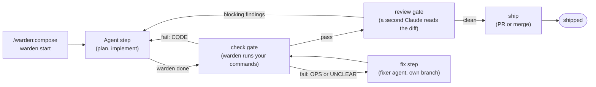

# Warden

A delivery harness for Claude Code: every task runs as a fixed list of steps, and the tests, the code review and the fixes of broken checks are run by warden itself, not left to the agent's word.

Warden is a Claude Code plugin. You install it once, set it up in your project with `/warden:init`, and from then on each task goes through steps such as plan, implement, check, review and ship. The agent cannot skip a step: hooks block the actions that do not fit the current step, and a step only ends when warden accepts its output.

## Why warden

An AI agent that writes code will sometimes say "tests pass" when they do not, push before a review, or "fix" a failing test by changing the test. Warden takes those calls away from the agent:

- **Warden runs the checks.** Your test, lint and build commands run in the background. The proof is tied to the exact commit (its git SHA), so a later edit cancels it.
- **A second Claude reviews the change.** Blocking findings send the task back to implement. A change that weakens a test or a check counts as blocking.
- **Failures are sorted before they are fixed.** A failed check is triaged as `CODE` (the change broke it), `OPS` (the setup broke it) or `UNCLEAR`. Code failures go back to the agent; the others go to a separate fixer agent that works on its own branch.
- **Nothing ships unproven.** The ship step delivers the commit that passed the checks and the review, and nothing else.

## Key features

- **Workflows from templates.** `do`, `chore`, `bugfix` and `feature`, or your own flow built from seven step types.
- **Engine-run gates.** `check` and `review` steps are run by warden, not by the agent.
- **Self-healing checks.** Triage rules, a fixer agent and fix notes that the project keeps. See [Gates and self-healing](docs/concepts/gates-and-self-healing.md).
- **Human sign-off when you want it.** An `approve` step waits until a person types `approve` or `reject: <why>`.
- **Worktrees per task.** Each task gets its own git worktree and branch, so several tasks can run side by side.
- **Epics.** `/warden:orchestrate` works through a set of tickets in dependency order.
- **Project-owned tools.** Your project keeps its own tools (ticket tracker, code graph, pull requests) in `.warden/tools/`.
- **A record of every task.** Steps, time and tokens are kept per task and shown on a local dashboard (`warden site`).
- **Periodic checks and retros.** Session start runs or offers the checks that are due.
- **Questions mid-step.** The agent can pause a step with `warden ask`; your next message is the answer. See [Blocked and waiting runs](docs/guides/blocked-and-waiting-runs.md).
- **Reports to the maintainers.** The agent can report a warden problem for you. Reports are kept on your machine; with write access to the warden repo they also reach the maintainers, and status changes and maintainer questions come back at session start. See [Reports](docs/concepts/reports.md).
- **Guided upgrades.** Each version that changes your project's files ships an upgrade note, and `/warden:upgrade` applies it. See [Upgrading](docs/getting-started/upgrading.md).
- **Built for agents.** The agent loads the `/warden:guide` skill when it is unsure or refused; [Guide for agents](docs/for-agents.md) is the long form.

## Quick start

You need [Claude Code](https://docs.anthropic.com/en/docs/claude-code), git, [Bun](https://bun.sh) 1.4 or newer (see [Installation](docs/getting-started/installation.md)).

1. Install the plugin, in a terminal or inside Claude Code (`/plugin`):

   ```bash
   claude plugin marketplace add thucxuong/warden#stable
   claude plugin install warden@warden-marketplace
   ```

   Then restart Claude Code or run `/reload-plugins`.

2. Open your project in Claude Code and set warden up:

   ```text
   /warden:init
   ```

   It scans your stack, drafts context files and check commands, asks you to confirm, then writes `.warden/`.

3. Commit the result and get it onto your main branch. `warden start` reads `.warden/` from there.

   ```bash
   git add .warden .gitignore scripts/warden-setup.sh
   git commit -m "chore: set up warden"
   git push
   ```

   If your main branch is protected, push a branch, open a pull request with these files, and merge it before your first task.

4. Start a task. The task id must match the pattern you chose during init.

   ```text
   /warden:compose APP-101 fix the typo in the settings page title
   ```

   The agent picks a template, starts the run in its own worktree and works through the steps. When a step waits for you, the agent tells you what to type.

The [quick start guide](docs/getting-started/quickstart.md) walks through a first feature task from start to ship.

## How it works



The agent asks warden what to do (`warden next`), does it, and hands in the result (`warden done`). Warden checks the result, moves the run to the next step, and runs the gate steps itself. See [How warden works](docs/concepts/how-warden-works.md).

## Documentation

| If you want to | Read |
|---|---|
| Install warden and run a first task | [Getting started](docs/getting-started/installation.md) |
| Understand runs, steps, gates and reports | [Concepts](docs/README.md#concepts) |
| Do a specific job (write a tool, run an epic, set up a team) | [Guides](docs/README.md#guides) |
| See time, tokens and cost per task | [Lead overview](docs/guides/lead-overview.md) |
| Look up a command, file or setting | [Reference](docs/README.md#reference) |
| Look up a word (proof, triage, leftovers, ...) | [Glossary](docs/README.md#glossary) |
| Work in a warden project as an AI agent | [Guide for agents](docs/for-agents.md) |
| Fix a problem | [Troubleshooting](docs/troubleshooting.md) and [FAQ](docs/faq.md) |
| Work on warden itself | [Maintainers](docs/maintainers/README.md) |

The full table of contents is in [docs/README.md](docs/README.md).

## Project status

Version 0.8.1. Warden is young and changes often. Each version that changes your project's files ships an upgrade note, and `/warden:upgrade` applies it (see [Upgrading](docs/getting-started/upgrading.md)). Changes are listed in [CHANGELOG.md](CHANGELOG.md).

## License

[MIT](LICENSE). Use, copy, change and sell warden for any purpose; keep the copyright notice.
