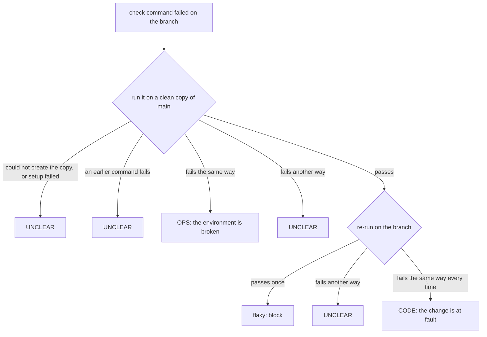

# Gates and self-healing

Gates are the steps the engine runs itself; when a check fails, warden finds out whose fault it is and sends the failure to the right place.

There are two gates: the **check gate** runs your commands, and the **review gate** runs an AI code review. When a check fails, **triage** decides why, and the **fixer** repairs problems that are not caused by the change.

## The check gate

A `check` step names a check set in `.warden/steps.json`, for example `"check": "default"`. A check set is a list of commands:

```json
"check": {
  "default": {
    "commands": [
      { "name": "lint", "run": "bun run lint" },
      { "name": "test", "run": "bun test", "timeoutSec": 600 }
    ]
  }
}
```

The engine:

1. Makes sure the working tree is clean. If it is not, the run goes back to implement with the reason "working tree is dirty". Implement may then hand in without a new commit.
2. Runs each command with `/bin/sh -c` in the worktree root, in order, one log file per command (`.warden/state/<task>/checks/<n>/<name>.log`). The default timeout is 900 seconds (at most 7200). A command that times out exits with 124.
3. Stops at the first command that fails. **Only the exit code counts**; the output text never decides pass or fail.
4. Stops and blocks the run if a command leaves new or changed files in the worktree. Add those files to `.gitignore` on the main branch, merge the main branch into the task branch, then type `retry`.
5. On a pass, records a proof for HEAD and moves on. On a failure, starts triage.

The agent never runs the checks to prove a step. The engine runs them, and the agent sees what ran in the next `message`, for example `warden ran: lint (pass, 3.1 s), test (fail, exit 1, 12.4 s) on 1a2b3c4`.

## Triage: whose fault is a failure?

A check can fail because the change is wrong (**CODE**), because the environment is broken (**OPS**: a setup script, a missing env file, a broken service), or for a reason warden cannot tell (**UNCLEAR**). Triage tells them apart by running the failing command again in two places:

- a **clean copy**: a fresh, separate checkout of the main branch at the branch's base commit, with setup run first;
- the **branch** itself, again, up to `triage.branchReruns` times (default 2, at most 3).

Two failures count as "the same" when their **signature** matches. A signature is a short fingerprint of the failing log: warden strips colours, replaces paths, timestamps, hashes and numbers, keeps up to five error-looking lines, and hashes them.



Each triage writes a report, `.warden/state/<task>/triage/<n>.json`, with every attempt, its log and its signature, the verdict and a one-line reason.

### Where each verdict goes

| Verdict | Next |
|---|---|
| CODE | Back to the latest implement step, with the reason, the last 80 lines of the log and the triage report path. On every third CODE verdict (`codeStrikes`, default 3; the count then starts again), the fixer gets it in diagnose mode instead. |
| OPS | The fixer, in normal mode. |
| UNCLEAR | The fixer, in diagnose mode: decide first whose fault it is, then fix. |
| Flaky (failed, then passed on a re-run) | The run blocks: "Fix the flaky test or its cause, then type retry". Warden does not hand flaky tests to the fixer. |

## Triage rules

`.warden/triage-rules.json` holds known failure patterns:

```json
{
  "schema": 1,
  "rules": [
    {
      "id": "TR-0001",
      "pattern": "^error: PORT is not set$",
      "flags": "",
      "verdict": "OPS",
      "fixNote": ".warden/fixes/2026-10-18-PG-001.md",
      "task": "PG-001",
      "addedAt": "2026-10-18"
    }
  ]
}
```

- A rule is a **label only**. It never decides the verdict; the clean copy and the re-runs do.
- When a rule matches a line of the failing log and the verdict is OPS, the reason says "known pattern TR-0001", and the fixer gets the old fix note to start from.
- A rule's `verdict` is `OPS` or `UNCLEAR`, never `CODE`.
- Warden reads the rules from the main branch only, so a task branch cannot add a rule that labels its own failure.
- The fixer adds rules. Each new rule must be narrow: it must match a line of the failing log and no line of any passing check log in the run, or warden refuses it as "too broad".

## The fixer

For OPS and UNCLEAR failures (and every third CODE verdict), the engine inserts a `fix-<n>` step. It:

1. Creates a fix branch `warden-fix/<task>-<n>` from the main branch, in its own worktree next to the task's worktree.
2. Asks the project's agent to hand the step to the `warden:fixer` subagent, in the foreground.

The fixer works only in the fix worktree, and only on files inside `fix.scope` from `.warden/steps.json`. The default scope is `scripts/**`, `.warden/tools/**`, `.warden/triage-rules.json`, `.warden/fixes/**`, `.warden/knowledge/**`, `docs/**`, `.env.example` and `docker-compose*.yml`. It may never change `.warden/steps.json`, `.warden/flows/`, `.warden/warden.json`, `.warden/tools/roles.json` or lockfiles, whatever the scope says. It never touches the task branch.

The fixer finds the root cause and fixes it at the source. It does not loosen a check, add retries, raise timeouts, skip tests or set `CI`. It ends with one of four results:

| Result | Meaning | What the engine does |
|---|---|---|
| `FIXED` | Fixed on the fix branch, with a fix note (`.warden/fixes/<date>-<task>.md`) and a new narrow triage rule. | Waits until the fix is on the main branch, then lands it (below). |
| `CODE` | The change on the task branch is at fault, with `path:line`. | Back to implement, with the fixer's `codeRef`. |
| `GAVE_UP` | A person must look, for example "main is red" or "cannot reproduce". | Blocks the run with the fixer's reason. |
| `WARDEN_BUG` | Warden itself is at fault. | Files a report to the warden maintainers and blocks the run. |

A `FIXED` result may skip the new note and rule in two cases: the triage report already named a matching rule (the fixer gives its id), or the fix is already on the main branch (the fixer gives its commit).

### Landing a fix

A fix lands only through the main branch. The task branch gets it by merging the main branch, never straight from the fix branch.

1. Warden checks that the fix note and the rule are on the main branch. It checks the content, not the commit history, so squash and rebase merges count.
2. If they are not there yet, the run waits: "merge <PR>, then type retry". Whether the fixer may merge its own PR depends on `PROJECT_AGENT=1` in the session (see [Team setup](../guides/team-setup.md)).
3. Once the fix is on the main branch, the engine merges the main branch into the task branch, runs setup and the fixer's `repairCommands` (for ignored local files only), and runs the gates again.

At most `fixerRounds` (default 2) fixes run per task. After that the run blocks for a person.

## The review gate

A `review` step runs an independent reviewer: a separate, read-only `claude -p` process.

- It sees the diff of the branch against its base (`git diff <base>...HEAD`), up to 400 KB. Lockfiles and `.warden/history/` are left out.
- It gets the task text, `review.rules` from `.warden/steps.json`, and the text of each file in `review.rulesFiles` (for example `AGENTS.md`).
- It may read files and run `git diff`, `git log` and `git show`. It cannot edit, write or use the web, and gets no MCP servers.
- It uses `review.model` (default `sonnet`), stops at `review.maxBudgetUsd` (default 2 dollars) and `review.timeoutSec` (default 1200).

### Findings

The reviewer returns findings: `{ file, line, severity, summary }`.

| Severity | Meaning |
|---|---|
| `blocking` | A correctness bug, a security issue, data loss, or a broken contract. A change that weakens a check (a skipped test, a looser assertion, an easier check script) is blocking unless the task asks for it. |
| `minor` | Everything else. Minor findings never block. |

Warden drops findings that are not on a line the change added or modified (within 3 lines), so the review stays about this change. Line 0 means a whole-file problem and is kept.

| Round result | Next |
|---|---|
| No blocking findings | Proof for HEAD; the run moves on. |
| Blocking findings, round below `reviewRounds` (default 3) | Back to implement, with the findings. |
| Blocking findings in the last round | The gate passes, and the findings are written as **leftovers** (`review/leftover.md`). The ship step must put them in the PR description under `## Unresolved review findings`. |
| The reviewer failed (bad output, rate limit, error), twice | The run blocks: "reviewer unavailable". |

The review rounds count over the whole run, not per implement step. Each round's cost and tokens are recorded.

## Proofs

A **proof** says that a gate passed on a given commit: `{ stepId, kind, sha }`. Proofs are what make a ship safe.

- Entering an implement step clears all proofs.
- A proof is valid while HEAD is the proven commit, or only the run record (`.warden/history/**`) and the ticket files the engine set at ship changed on top of it, and the working tree is clean.
- At the ship step, the engine checks that every check and review after the latest implement has a valid proof. If not, it runs those gates again on the new HEAD. After three such "stale proofs" the run blocks: "code keeps changing after the gates".
- Pushing, opening a pull request and merging are allowed only when the proofs cover HEAD.

### When the code moves during a gate

If HEAD or the working tree changes while a gate runs, the result is thrown away and the gate runs again, at most twice. Then the run blocks: "do not edit or commit during gates, then type retry".

### Retrying a blocked gate

When a person types `retry` on a blocked check or review step, the engine first merges the main branch into the task branch (when the main branch has new commits), moves the base, runs setup, and then runs the gate again. A merge conflict blocks with the files to fix by hand.

## See also

- [How warden works](how-warden-works.md)
- [Workflows](workflows.md)
- [State and history](state-and-history.md)
- [Blocked and waiting runs](../guides/blocked-and-waiting-runs.md)
- [steps.json reference](../reference/steps-json.md)
- [Project files](../reference/project-files.md)
- [Troubleshooting](../troubleshooting.md)
