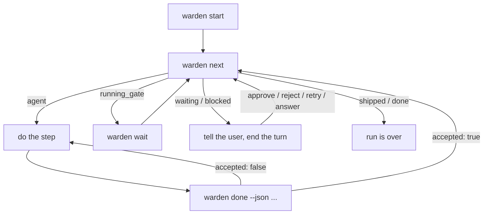

# How warden works

Warden runs each task as a fixed list of steps, and only moves on when a step's result is proven.

## The parts

| Part | What it is |
|---|---|
| Task | One piece of work with an id that matches `taskIdPattern` in `.warden/warden.json`, for example `PG-012`. |
| Flow | The list of steps for a task. Warden ships four templates (`do`, `feature`, `bugfix`, `chore`); you can write your own. See [Workflows](workflows.md). |
| Run | One task going through one flow. It has a status, a current step, counters and proofs. Its state lives in `.warden/state/<task>/`. |
| Step | One stage of the flow. Some steps are done by the project's agent, some by the engine, one by a person. |
| Engine | The warden code that keeps the run's state, checks every hand-in, and runs the gates. |
| Gate | A step the engine runs itself: `check` (your test commands) and `review` (an AI code review). See [Gates and self-healing](gates-and-self-healing.md). |
| Worktree | A separate git checkout for the task's branch, so several tasks can run side by side. See [State and history](state-and-history.md). |

## Who does each step

| Step type | Done by | What happens |
|---|---|---|
| `analyze`, `plan`, `implement`, `ship` | the project's agent | The agent reads the instructions, does the work, and hands in a JSON result with `warden done`. |
| `fix` | the `warden:fixer` subagent | Inserted by the engine when a check fails for a reason that is not (only) the change. |
| `check`, `review` | the engine | Runs in a background process. The agent waits with `warden wait`. |
| `approve` | a person | The run waits until a person types `approve` or `reject: <why>`. |

## The loop

The project's agent drives a run with three commands. Each prints one JSON object.

| Command | What it does |
|---|---|
| `warden next [<task>]` | Shows what the current step needs: `status`, `message`, `instructions`, the `output` schema with an example, and `context` (paths to the task text, the plan, findings to fix). |
| `warden done [<task>] --json '<output>'` | Hands in the step's output. Returns `accepted` and a list of `errors`. It never waits. |
| `warden wait [<task>]` | Blocks while a gate runs (up to 540 seconds by default), then prints the same shape as `warden next`. |

The `status` field of `warden next` tells the agent what to do:

| `status` | Meaning | What the agent does |
|---|---|---|
| `agent` | An agent step is open. | Do the step, then `warden done`. |
| `running_gate` | The engine is running a check, a review, ship prep or a fix landing. | Run `warden wait`. Do not edit or commit. |
| `waiting` | The run waits for a person: an approval, a fix to be merged, or the answer to a question. | Show the `message` to the user and end the turn. |
| `blocked` | Something needs a person to look. | Show the `message` and end the turn. The user fixes the cause and types `retry`. |
| `shipped` | The ship step was handed in. | Stop. |
| `done` | The flow has no more steps. | Stop. |

The `/warden:work` skill runs this loop for the agent. `/warden:compose` picks a flow and calls `warden start` first.

## Starting a run

`warden start <task> --template <name>` (or `--flow <name|path>`) does this, in order:

1. Checks the task id against `taskIdPattern`.
2. Fetches the main branch and reads `.warden/steps.json` from it. Your `.warden/` folder must be committed and pushed to the main branch first.
3. Checks the flow with the flow linter. A bad flow never creates a worktree.
4. Refuses when a run for this task already exists.
5. With `--worktree`, creates or reuses a worktree for the task's branch. Without it, uses the current branch, which must not be the main branch.
6. Copies the flow and `steps.json` into the run's state folder. The run uses these copies until it ends, so editing the files later does not change a live run.
7. Runs the setup commands from `steps.json` in the worktree. If one fails, the run is not created and the log is kept in the temp folder.
8. Enters the first step.

The task text comes from `--text`, `--text-file`, or, with `--ticket`, from the project's ticket tool. Without any of them the run stores only the id, and `warden next` tells the agent to ask the user what the task is.

## What the agent is told

At an agent step, `instructions` holds these sections, in this order (empty ones are left out):

1. **Task**: the task text.
2. **Step**: what the step must achieve and which files it may change.
3. **How this project does it**: `agent.<step type>.instructions` from `.warden/steps.json`.
4. **Notes for this step**: the step's own `instructions` field in the flow.
5. **Back from ...**: when a gate sent the run back, the reason, the findings or the last 80 lines of the failing log, and the triage report path. For a fix step, the fix context instead.
6. **Project rules**: the text of `.warden/rules/*.md` (up to 16 KB).
7. **Read as needed**: the `INDEX.md` of `.warden/context`, `.warden/knowledge` and `.warden/decisions`.
8. **Earlier outputs**: paths to the accepted outputs of earlier steps, and `plan.md`.
9. **Hand back**: the exact `warden done` command to run.

## How a hand-in is checked

`warden done` checks the output in three passes. The output is accepted only when there are no errors.

1. **JSON**: it must parse and be an object.
2. **Shape**: the fields of the step's output type, for example `summary`, `filesChanged` and `testsAdded` for implement.
3. **Git evidence**: what the agent claims is compared with what git shows. For example:
   - `filesChanged` must equal the files that really changed since the step started.
   - An implement step must have a new commit and nothing uncommitted.
   - An implement step with no tests needs a `testsReason` of at least 10 characters.
   - A plan must not contain placeholders such as `TBD` or `TODO`, and every decision file it lists must exist.
   - Each step type may change only certain files. A plan step, for example, may only write `.warden/knowledge/` and `.warden/decisions/`.
   - A ship output needs proven gates for HEAD and a committed run record.

Every hand-in, accepted or not, is saved under `.warden/state/<task>/outputs/`. The errors of a rejected one are in its `output.rejected` event in `.warden/state/<task>/events.jsonl`, so you can see what went wrong.

## The engine worker

Gates can take minutes, so the engine runs them in a detached background process, the worker (`warden gate <task>`, logged to `.warden/state/<task>/gate.log`). `warden done` starts it and returns at once.

- Only one worker runs per task. A lock file (`.warden/state/<task>/.lock`) keeps two commands from changing the run at the same time.
- If the worker dies (a crash, a closed laptop), the next `warden next`, `warden wait`, `warden done`, session start or Stop hook starts a new one. Killing `warden wait` does not stop the worker.
- The worker runs without `PROJECT_AGENT`, with warden's `bin` first on `PATH`. Setup and check commands also get `WARDEN_TASK`, `WARDEN_MAIN_ROOT` and `WARDEN_WORKTREE`. Warden never sets `CI`.

## Why steps cannot be skipped

Several layers work together. Each one closes a shortcut.

| Layer | What it stops |
|---|---|
| The engine runs the gates | The agent cannot hand in a check or review step: `warden done` refuses with "check steps are run by the engine". A claim that "tests pass" counts for nothing. |
| Git evidence on every hand-in | The agent cannot claim files or commits that do not exist, or change files its step may not change. |
| Proofs tied to a commit | A passed gate records the commit (HEAD sha) it ran on. If the code changes after the gates, the proofs no longer count and the gates run again. See [Gates and self-healing](gates-and-self-healing.md#proofs). |
| Gate results are thrown away when the code moves | If HEAD or the working tree changes while a gate runs, the engine discards the result and runs it again. After two reruns it blocks. |
| Hooks | Claude Code hooks block edits to engine files, edits outside the step's allowed files, pushes and pull requests before the gates pass, and commands that are for a person. See below. |
| Person-only commands | `warden approve`, `warden retry` and `warden reset` need a terminal (a TTY). The agent's Bash tool has none, so they fail with exit code 6. The hook also denies them. |
| Branch protection | Your main branch requires a pull request. This is the hard guarantee: the hooks catch the common shortcut, but they are not a sandbox. |

### The hooks

Warden installs five Claude Code hooks. They do nothing in a project without `.warden/warden.json`, and they fail open: an internal error is logged to `hook-errors.log` in the warden data folder and the session goes on.

| Hook | What it does |
|---|---|
| SessionStart | Prints one line per live run (where it stopped, what it waits for), restarts dead workers, and adds notes: upgrades, due checks, report news, stopped orchestrations. |
| UserPromptSubmit | Turns the words `approve`, `reject: <why>` and `retry` (optionally followed by a task id) into the matching engine action. Answers a `warden ask` question with the user's message. Never blocks the prompt. |
| PreToolUse | Checks every Edit, Write and Bash call. It denies writes to `.warden/state/` and `.warden/history/`, edits a step may not make, changes to the locked config files (`steps.json`, `flows/`, `warden.json`, `triage-rules.json`, `tools/roles.json`; see [Workflows](workflows.md#gate-files-and-locked-config)) while a run is live, push, PR and merge commands before the gates pass, `warden approve|retry|reset`, setting warden's own variables (`PROJECT_AGENT`, a few `WARDEN_*` names, `CLAUDE_PLUGIN_ROOT`, `CLAUDE_PLUGIN_DATA`; the list is in [Hooks](../reference/hooks.md)), and nested `claude -p`. It also links the session to the task, for token counts. |
| Stop | Keeps the agent working while its run is active, so it does not end the turn in the middle of a step. It lets the turn end when the agent asks the user a question, while a fixer subagent is still out, in an orchestrating session, and after three blocks in a row. |
| SubagentStop | Links a subagent's own transcript to the task, for token counts. |

Every denial is written to the run's events as `hook.denied`. See [Hooks reference](../reference/hooks.md) for the exact rules and messages.

## When the agent needs the user

At an agent step the agent can run `warden ask "<question>"`. The run then waits with the question, the Stop hook lets the turn end, and the user's next message is the answer. The run goes on at the same step. When several runs are live, the user starts the answer with the task id. A subagent cannot use `warden ask`.

## See also

- [Workflows](workflows.md)
- [Gates and self-healing](gates-and-self-healing.md)
- [State and history](state-and-history.md)
- [Blocked and waiting runs](../guides/blocked-and-waiting-runs.md)
- [Guide for agents](../for-agents.md)
- [CLI reference](../reference/cli.md)
- [Hooks reference](../reference/hooks.md)
