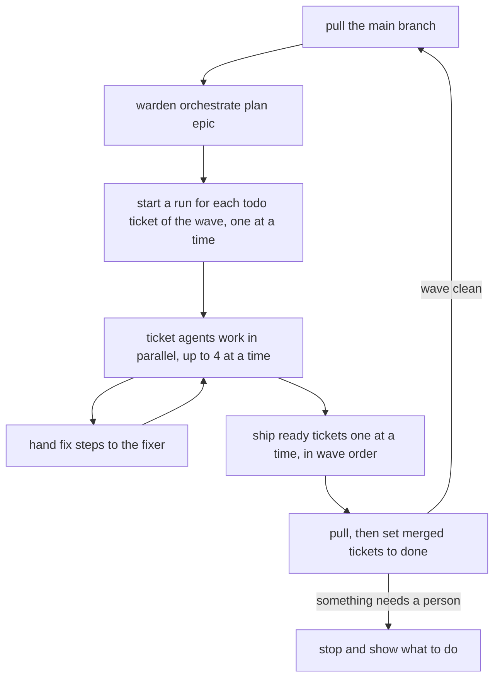

# Orchestration

Orchestration works through all tickets of an epic: it orders them by their dependencies, runs them side by side, and ships them one at a time.

It needs a ticket tool: a project tool set as the `tickets` role in `.warden/tools/roles.json`. See [Tools and roles](tools-and-roles.md) and [Write a ticket tool](../guides/write-a-ticket-tool.md).

## Words

| Word | Meaning |
|---|---|
| Epic | A parent ticket. Its direct children are the tickets to do. |
| Ticket DAG | The tickets and their `blocked_by` links. DAG means a graph with no loops: a ticket never waits on itself, directly or through others. |
| Wave | A group of tickets whose blockers are all done or in earlier waves. Wave 1 can start now. |
| Held ticket | A ticket that waits on an open ticket outside the epic. It gets no wave. |
| Ticket agent | A `warden:ticket` subagent that drives one ticket's run in its own worktree. |
| Orchestrator | The main Claude session running `/warden:orchestrate <epic>`. It starts runs and agents but never does a ticket's steps itself. |

## Planning

`warden orchestrate plan <epic>` asks the ticket tool for the epic's children (`dag <epic>`), builds the waves, and saves the plan to `.warden/state/_orchestrate/<epic>.json`. It prints the plan as JSON:

| Field | Meaning |
|---|---|
| `tickets` | Every child, sorted by id, with `wave`, `template`, `phase` and `run` (the live run, if any). |
| `waves` | The open tickets, wave by wave. |
| `next` | The first wave: the tickets to work on now. |
| `held` | Tickets waiting on an open ticket outside the epic, on a held ticket or on a `backlog` child, with those blockers. |
| `backlog` | Children with status `backlog`: parked, never in a wave. |
| `errors` | Problems that stop the plan: a bad row from the tool, an id that does not match `taskIdPattern`, a ticket blocked by itself, an unknown blocker, a cycle (shown as `cycle: A -> B -> A`). |
| `complete` | `true` when every child is `done` or `archived`. A closed blocker (`done` or `archived`) never holds a ticket back. |

The command exits 1 when `errors` is not empty. `warden orchestrate status <epic>` prints the saved plan again with each ticket's run and phase read fresh; it does not ask the ticket tool.

### Which template a ticket gets

The ticket's `type` from the ticket tool decides the flow:

| Ticket type | Template |
|---|---|
| `bug` | `bugfix` |
| `chore`, `docs` | `chore` |
| no type, `feature`, `story`, `user story`, `product backlog item`, `task`, `enhancement` | `feature` |
| anything else | `compose`: the orchestrator writes a flow that ends with a ship step |

## Phases

Each ticket has a phase, from its ticket status and its run:

| Phase | Meaning |
|---|---|
| `todo` | No run yet. |
| `running` | The run is active at an agent step or a gate. |
| `fix` | The run is at a fix step. |
| `ready` | The run reached its ship step and no gate is running. |
| `waiting` | The run waits for a person (an approval, a fix merge). |
| `blocked` | The run is blocked. |
| `pr-open` | Shipped with a pull request that is not merged. |
| `merged` | Shipped and merged. |
| `no-ship` | The run ended without a ship step. |
| `done` | The ticket's status is `done`. |

## The orchestration loop

`/warden:orchestrate <epic>` runs this loop:

1. From the main checkout, pulls the main branch (`git pull --ff-only`). If that fails, it stops.
2. Plans the epic. It stops on `errors`. On the first plan of the conversation it shows a table (wave, id, title, template, phase) and asks you to go ahead.
3. **Starts runs** for the `todo` tickets of the first wave, one at a time: `warden start <id> --template <template> --ticket --worktree`. Each ticket gets its own worktree, branch and run.
4. **Works in parallel.** It starts one `warden:ticket` agent per `todo` or `running` ticket, up to 4 at a time, always in the foreground (a background agent cannot ask for permissions, so its commands would be denied). Each agent drives its run until it reaches the ship step, a fix step, or something a person must do, then replies with one line such as `READY PG-012` or `BLOCKED PG-013: <message>`.
5. **Hands fix steps to the fixer.** For each ticket in `fix`, the orchestrator gives the step to a `warden:fixer` agent and passes the result to `warden done`. Then the ticket works on.
6. **Ships one at a time**, in wave order. For each `ready` ticket, a ticket agent in ship mode first merges the latest main branch into the ticket branch, fixes any conflicts, and then lets warden run the gates again on the merged code. Only then does it ship. If a ticket does not end `merged`, no more tickets ship in this call.
7. **Marks merged tickets done.** After pulling the main branch, it runs `warden orchestrate set-status <id> done` and commits the changed ticket files on the main branch. It never pushes the main branch.
8. **Stops** when any ticket of the wave is `blocked`, `waiting`, `pr-open`, `no-ship`, still `running` after 3 agent runs, or asked a question. It shows a table with each ticket, its phase, the reason, and what you do: type `retry <id>`, type `approve <id>`, merge the PR, or answer the question. Otherwise it goes on with the next wave.
9. When the epic is complete, it sets the epic to `done`, removes the shipped tickets' worktrees and merged branches, and shows a final table with each ticket's PR or merge commit.

Run `/warden:orchestrate <epic>` again to go on after a stop. The saved plan and the live runs pick up where they were. Session start also reminds the agent: `warden: orchestration of <epic> stopped with <n> tickets left`.

## Why shipping is one at a time

Each ticket was checked and reviewed on its own branch. Once another ticket lands, that is no longer the code it will merge into. So the orchestrator ships in order, and each ticket first merges the main branch as it is now. Warden then runs the gates again on the merged commit, because the proofs no longer cover HEAD. Every ticket is gated on the code it actually lands on.

## Rules for the orchestrator and ticket agents

- Ticket agents never ask you directly and never run `warden ask`. When a person must decide, the agent replies `ASK <id>: <question>`, and the orchestrator brings the question to you. Your answer goes back to the agent as a `Note`.
- The orchestrator trusts `warden orchestrate status`, not the agents' replies (except `ASK`).
- The orchestrator never edits files in a ticket worktree and never runs checks.
- The Stop hook does not keep an orchestrating session going, even when its folder is inside a ticket worktree.

## Commands

| Command | What it does |
|---|---|
| `warden orchestrate plan <epic>` | Builds and saves the plan (asks the ticket tool). |
| `warden orchestrate status <epic>` | The saved plan with runs and phases read again. Exit 3 if there is no saved plan. |
| `warden orchestrate set-status <id> <status>` | Runs the ticket tool's `set-status` in the main checkout. Status is `backlog`, `todo`, `doing`, `review`, `done` or `archived`. Prints `{id, status, changed}`. |

All three exit 3 when no `tickets` role is set.

## See also

- [Orchestrate an epic](../guides/orchestrate-an-epic.md)
- [Write a ticket tool](../guides/write-a-ticket-tool.md)
- [Tools and roles](tools-and-roles.md)
- [Workflows](workflows.md)
- [Blocked and waiting runs](../guides/blocked-and-waiting-runs.md)
