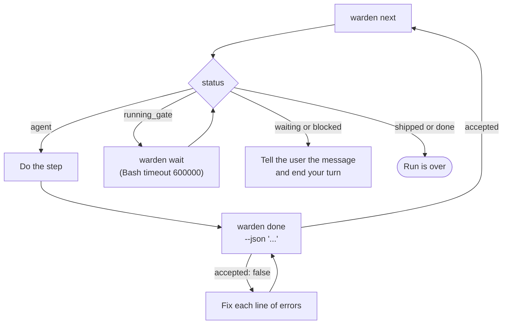

# Guide for agents

How a Claude Code session (the project's agent) works in a project that uses warden: the rules, the loop, and what to do when warden says no.

The short form ships with the plugin as the [`/warden:guide`](reference/skills.md#wardenguide) skill, so the project's agent can load it at any time. This page is the long form; on a machine with warden installed it is usually at `~/.claude/plugins/marketplaces/warden-marketplace/docs/for-agents.md`.

## The short version

- Warden decides the steps. You ask with `warden next`, do the step, and hand in with `warden done`.
- Warden runs the checks and the code review itself. Your word that "tests pass" counts for nothing.
- A person approves, rejects, retries and resets. You tell the user what to type.
- When warden refuses something, it says why in a line that starts with `warden:`. Fix the cause. Do not look for a way around it.

## Golden rules

| Never | Why |
|---|---|
| Run the checks to prove a step | The engine runs them on the exact commit (its git SHA). Your run proves nothing. |
| Write under `.warden/state/` or `.warden/history/` | Only the engine writes there. Hooks refuse it. |
| Push, open a pull request or merge outside the ship step | Hooks refuse it until all gates pass for HEAD. |
| Run `warden approve`, `warden retry` or `warden reset` | They are for a person. The hook refuses them and they need a terminal anyway (exit 6). |
| Set `PROJECT_AGENT`, any `WARDEN_*` or `CLAUDE_PLUGIN_*` variable on a command, or start `claude -p` | That changes how warden itself runs. Hooks refuse warden's own variables (the list is in [Hooks](reference/hooks.md), rule B2) and nested `claude -p`. |
| Edit the locked config files while a run is live: `.warden/steps.json`, `.warden/flows/`, `.warden/warden.json`, `.warden/triage-rules.json`, `.warden/tools/roles.json` | The live run's checks depend on them. The hook message calls them gate files. |
| Edit or commit while a gate runs (`running_gate`) | The engine throws the result away when HEAD or the tree moves, and blocks after the third time. |
| Start a second run for a task that has one | `warden start` refuses: a run for that task exists. |
| Start the fixer or a ticket agent with `run_in_background` | A background agent cannot ask for permissions, so its Bash calls are denied. |

| Always | How |
|---|---|
| Use the worktree warden picked | `warden start` prints `worktree`. Work there, even if a project doc describes another layout. |
| One simple command per Bash call | `git -C <dir> ...` and absolute paths. A plain `cd <dir>` on its own is fine; never `cd <dir> && ...`. Permission rules such as `Bash(git *)` do not match a chained command. |
| Hand in on one line | `warden done --json '<json>'`. No heredoc, pipe or temp file. |
| Keep notes | Something surprised you: add a line to `.warden/knowledge/<area>.md`. You made a choice: write `.warden/decisions/NNNN-<slug>.md` (never edit an old one). Add the file's line to the folder's `INDEX.md` in the same commit. |
| Look for tools first | `warden tools` lists the project's tools and roles. If a `graph` role is listed, run `warden tools graph query "<question>"` before a broad search. |

## The loop



1. Run `warden next` (with the task id when you are not in its worktree: `warden next <task>`).
2. Read the JSON it prints:

   | Field | What it holds |
   |---|---|
   | `status` | `agent`, `running_gate`, `waiting`, `blocked`, `shipped` or `done` |
   | `step` | `id`, `type`, `index`, `total`, `title`; `null` once the run is over |
   | `message` | One or more lines for you, for example `APP-12: implement (2/5). Back from check: CODE.` |
   | `instructions` | What the step must achieve, the project rules, what to read, and earlier outputs |
   | `output` | `schema` (the TypeScript type to hand in) and `example` |
   | `context` | `taskPath`, and when they apply `planPath`, `routeBack`, `fix`, `ship`, `waiting` |

3. Go by `status`:

   | Status | Do this |
   |---|---|
   | `agent` | Do the step as `instructions` says, then hand in. |
   | `running_gate` | Run `warden wait` with a Bash timeout of 600000. It waits up to 540 seconds. Repeat until the status changes. |
   | `waiting` | Tell the user the `message` and end your turn. |
   | `blocked` | Tell the user the `message` and end your turn. |
   | `shipped`, `done` | Tell the user the run is over. |

The Stop hook keeps your turn going while the run needs you. If it says `<task> is at <step> and needs you`, run `warden next` (or `warden wait` while a gate runs).

### Starting a run

Usually the user starts with `/warden:compose <task-id> <what to do>`, or the `/warden:work` skill starts one. When you must start it yourself:

1. Run `warden next`. If it says there is no active run here and lists your task among the live runs, run `cd <its worktree>` as its own command, then `warden next`. Skip the rest of this list.
2. The task id must match `taskIdPattern` in `.warden/warden.json`. If the user gave only text and the ticket tool has `create`, create the ticket as `/warden:compose` says ("No task id"): the tool picks the id. Otherwise ask for an id.
3. Pick the template as `/warden:compose` does: `feature` for a new feature, schema or API change, many files, new UI, an auth entry point, or no label; `bugfix` for a bug in existing code; `do` for docs, config only, a typo or a single-file obvious edit; `chore` for a small change that must be merged, such as a chore ticket.
4. Run one of these, with a Bash timeout of 600000 (start runs the project setup):

   ```bash
   warden start APP-12 --template feature --ticket --worktree
   warden start APP-12 --template feature --text "Add a CSV export to the report page" --worktree
   ```

   Use `--ticket` only when `warden tools` lists a `tickets` role and `warden tools tickets show <id>` finds the ticket.
5. Run `cd <worktree>` as its own command, then `warden next`.

## What each step asks of you

| Step | What you do | What you may change in the worktree |
|---|---|---|
| `analyze` (generic) | Read the code, record facts with `file:line`, list follow-up tickets. | `.warden/knowledge/`, `.warden/decisions/` |
| `analyze` (reproduce) | Write the smallest failing test. Run only that test. Leave it uncommitted; implement commits it. | Anything but gate files |
| `analyze` (diagnose) | Write the chain from symptom to root cause, each link tied to evidence. | `.warden/knowledge/`, `.warden/decisions/` |
| `analyze` (spike) | Answer the question in one note, pass it as `notePath`. | `.warden/knowledge/`, `.warden/decisions/`, `docs/` |
| `plan` | Follow the plan skill. Hand in `PlanOutput`. No placeholders such as `TBD` or `TODO`. | `.warden/knowledge/`, `.warden/decisions/` |
| `implement` | Make the change with tests. Commit all of it. When back from a gate, fix exactly what it reports. | Anything but gate files |
| `ship` | Commit the run record, open the PR or merge as the project says, hand in `ShipOutput`, then run `warden clean` from the main checkout. Never remove the worktree before the hand-in. | `.warden/history/<task>/` and the ticket files warden changed |
| `fix` | Hand the step to the `warden:fixer` agent in the foreground, wait, and pass its JSON to `warden done`. | Nothing. The fixer works in its own fix worktree. |
| `check`, `review` | Nothing. The engine runs them. `warden done` refuses. | Nothing |
| `approve` | Nothing. A person types `approve` or `reject: <why>`. | Nothing |

## Handing in output

One command, the JSON on one line in single quotes:

```bash
warden done --json '{"summary":"Apply tax once","filesChanged":["src/cart.ts","tests/cart.test.ts"],"testsAdded":["tests/cart.test.ts"]}'
```

- Write a single quote inside the JSON as `\u0027`. (For `--text` in `warden start`, the compose skill writes a single quote as `’` instead.)
- `warden done --file <path>` also works, but `--json` keeps it to one simple command.
- `warden done` returns at once. It prints `{"accepted", "errors", "next"}`, where `next` is the same shape as `warden next`. Exit 0 when accepted, 1 when not, 4 while engine work is running.
- For implement, `filesChanged` is exactly what `git -C <worktree> diff --name-only <step start> HEAD` prints. The step start SHA is in the instructions (`Step start: <sha>`).

Shapes for the common steps (the full schema is always in `output.schema`):

```json
{"summary":"...","filesChanged":["src/a.ts"],"testsAdded":["tests/a.test.ts"]}
```

```json
{"summary":"...","filesChanged":["src/a.ts"],"testsAdded":[],"testsReason":"config only, no behaviour to test"}
```

```json
{"pr":"https://example.com/pr/12","merged":false,"mergeCommit":null,"description":"Fix double tax."}
```

## When you need the user

At an agent step, ask through warden so the run waits and your turn may end:

```bash
warden ask "Should the export include archived rows?"
```

From outside the run's worktree, pass the task id: `warden ask APP-12 "<question>"`. Show the user the question and end your turn. Their next message is the answer. Then run `warden next` and go on with the step.

- The question is 1 to 500 characters.
- `warden ask` works only at an agent step with no engine work running.
- A subagent cannot ask. A ticket agent replies `ASK <Task>: <question>` to its caller instead.

## Blocked and waiting runs

Tell the user the `message` and end your turn. They type one of these in the chat.

While a run is blocked at a check, review or approve step, your edits in the ticket worktree are refused (`<type> step does not change code`). So the person fixes the cause in their own editor or terminal, commits in the worktree, and then types `retry`. If the user asks you to fix it, explain this. You can still read files and tell them what to change.

| The run says | The user types |
|---|---|
| `waiting for you: <prompt>. Type "approve" or "reject: <why>".` | `approve`, or `reject: <why>` |
| `is blocked: <reason>` | Fix the cause, then `retry` |
| `the fix is not on <main> yet; merge <pr>, then type retry` | Merge that pull request, then `retry` |
| `is waiting for your answer: <question>` | The answer |

With several live runs, the user adds the task id: `approve APP-12`, `retry APP-12`, `reject APP-12: <why>`, or `APP-12: <answer>`. See [Blocked and waiting runs](guides/blocked-and-waiting-runs.md).

## Common refusals and the fix

### From `warden done`

| `errors` line | Fix |
|---|---|
| `output is not valid JSON: ...` | Send one line of valid JSON in single quotes. |
| `output must be a JSON object` | Wrap the fields in `{...}`. |
| `filesChanged is missing <path>` | Add the path, or undo that change. |
| `filesChanged lists <path>, which did not change` | Remove the path from the list. |
| `uncommitted changes: <paths>` | Commit them (implement), or remove them. |
| `no new commit` | Implement must commit its work. |
| `testsReason: required (at least 10 chars) when testsAdded is empty` | Add a test, or say why there is none. |
| `testsAdded: <path> is not in filesChanged` | A test you list must also be in `filesChanged`. |
| `<path>: not allowed in <type> step` | Undo the change; see the table of steps above. |
| `planMarkdown line N: placeholder "<word>"` | Write the real content. |
| `task Tn: blockedBy Tm is not a task of an earlier wave` | Move `Tm` to an earlier wave, or drop the link. |
| `decisions: <file> does not exist` | Write the decision file, or drop it from the list. |
| `reproduction.failingTest: <path> does not exist` | Write the test at that path. |
| `the run record is not committed: commit .warden/history/<task>/` | Do step 1 of the ship instructions first. |
| `gates are not proven for HEAD: ...` | The code changed after the gates. Run `warden next`; the gates run again. |
| `pr or mergeCommit is required` | Give the pull request or the merge commit. |
| `description: must contain the "## Unresolved review findings" section` | Put the leftovers file text in the description under that heading. |
| `engine work is running; run: warden wait` (exit 4) | Run `warden wait`. |
| `check steps are run by the engine` | Nothing to hand in. Run `warden wait`. |
| `<task> is <status> at <step>; there is no agent step to hand in` | Run `warden next` and read the status. |

### From the hooks

Each hook refusal starts with `warden:`.

| Message | Fix |
|---|---|
| `approve, retry and reset are for a person. Ask the user to type "approve" / "retry".` | Do that. |
| `this command changes how warden itself runs; ask the user to do it` | Remove the variable (`PROJECT_AGENT`, `WARDEN_ROLE`, `WARDEN_CLAUDE_BIN`, `WARDEN_DATA`, `WARDEN_ROOT`, `WARDEN_TEST_MODE`, `CLAUDE_PLUGIN_ROOT`, `CLAUDE_PLUGIN_DATA`) or `claude -p` from the command. |
| `state, history and gate files are written by the engine only` (Bash) / `state and history are written by the engine only` (Edit, Write) | Leave those files alone. |
| `<type> step does not change code (<task> at <step>)` | This step allows no such edit. Hand in what the step asks for. |
| `gate files cannot change while a run is live (<task>); finish or reset it first` | Change them after the run, or ask a person to reset it. |
| `push/PR/merge is allowed only in the ship step after all gates pass for HEAD (<task> at <step>)` | Keep going with `warden next` until the ship step. |
| `only the warden:fixer subagent edits the fix worktree` / `pushes the fix branch` | Hand the fix step to the `warden:fixer` agent. |
| `the fixer works in <path>, not the ticket worktree` | During a fix step, leave the ticket worktree alone. |
| `outside the fixer scope` | (Fixer only.) Change only files that `fix.scope` allows. |
| `a subagent cannot ask the user; stop and give the question back to the caller` | Reply to the caller with the question. |

### From other commands

| Message | Fix |
|---|---|
| `no active run in this worktree; live runs: ...; pass the task id: warden next <task>` | Pass the task id, or `cd` into that run's worktree. |
| `several runs here; pass the task id` | Pass the task id. |
| `task is busy: another warden command holds the lock` (exit 4) | Run the command again in a moment. |
| `a run for <task> exists (status <s>); a person can run warden reset <task>` | Use the existing run (`warden next <task>`). |
| `on <main>: start on a ticket branch, or pass --worktree` | Add `--worktree`. |

More in [Troubleshooting](troubleshooting.md). Exit codes are in [Exit codes](reference/exit-codes.md).

### A refusal that matches no row

1. Read the whole message: most refusals name the fix or the command to run.
2. Run `warden <command> --help` and check your arguments.
3. Do not try another way around the refusal (a different tool, a shell trick, editing state files).
4. If the fix needs a person (approve, retry, reset, a locked file), tell the user what to type and end your turn.
5. If warden itself looks wrong or unclear, file it with `/warden:report`, with the exact message.

## Session start lines

At the start of a session, warden adds lines that begin with `warden:`. Act on them like this:

| Line | Do this |
|---|---|
| `<task> stopped at <step> (...). Run: warden next` | Resume with `warden next <task>`. |
| `<task> is blocked: ...` / `is waiting for you: ...` / `is waiting for your answer: ...` | Tell the user what to type. |
| `updated to <v>; this project is on <old>. ...` | When the user's request is done, offer the upgrade. With their OK, run `/warden:upgrade`. |
| `version <v> is available; ...` | Tell the user. Updating the plugin is their call, in a terminal. |
| `checks due: ...` | When the request is done, offer them in one short line. Start one only if the user says yes. |
| `auto checks failed on their last run: ...` | Tell the user in one short line. Details: `warden checks`. |
| `orchestration of <epic> stopped with N tickets left. ...` | When the request is done, offer to go on. With their OK, run `/warden:orchestrate <epic>`. |
| `report <id> "<title>" is now <status>. ...` | Tell the user. For `needs-info`, answer it (below). |
| `when the user's current request is done, run warden report --status --write. ...` | Do that, then commit `.warden/reports.md` as the line says. |
| `not set up here. Run /warden:init.` | Tell the user. Only a person can start `/warden:init`. |

## Reporting a warden problem

When warden itself behaves against its own instructions (not when your code fails a check), send a report:

```bash
warden report --kind bug --title "warden wait never returns after review" --body "What happened: ... Expected: ... Steps: ... Evidence: <exact output>"
```

- Kind is `bug` or `enhancement`. The body is one argument; for a long body use `--file <path>`.
- No repository names, links, secrets, credentials or customer data.
- It prints `{"id": "R-xxxx-NNNN", "status": "sent"}`. Tell the user the id.
- The row goes to `.warden/reports.md` in the main checkout. Commit it there only when the main checkout is on the main branch and nothing else is staged: `git -C <main> commit -m "chore: warden report <id>" -- .warden/reports.md`. Never on a task branch. Do not push unless the user asks.

When a report needs more information, session start shows the question. Answer it from the project's code, config and logs, in one argument:

```bash
warden report reply R-eb85-0001 --body "<answer>"
```

See [Reports](concepts/reports.md).

## Commands you run, and commands you never run

| You run | A person runs (never you) |
|---|---|
| `warden next`, `done`, `wait`, `ask`, `status` | `warden approve <task>` |
| `warden start` (when no run exists) | `warden retry <task>` |
| `warden flow check`, `warden flow save` | `warden reset <task>` |
| `warden tools`, `warden tools <name> ...` | `/warden:init` |
| `warden checks`, `warden checks run <name>` (after the user agrees) | `claude plugin update ...` |
| `warden report ...`, `warden report reply` | |
| `warden docs check` | |

## See also

- [How warden works](concepts/how-warden-works.md)
- [Gates and self-healing](concepts/gates-and-self-healing.md)
- [Blocked and waiting runs](guides/blocked-and-waiting-runs.md)
- [CLI reference](reference/cli.md)
- [Hooks](reference/hooks.md)
- [Skills](reference/skills.md)
- [Troubleshooting](troubleshooting.md)
