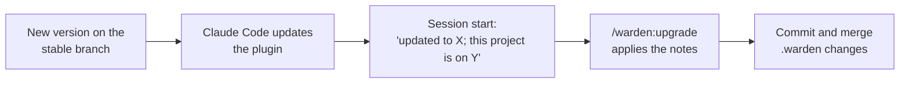

# Upgrading

How a new warden version reaches your machine, and how `/warden:upgrade` brings your project's files up to date with it.

An upgrade has two parts:

1. **The plugin code** on each person's machine. Claude Code updates it from the marketplace.
2. **Your project's files** in `.warden/`. Some versions change their layout. `/warden:upgrade` applies those changes once, and you commit them for the whole team.

`.warden/warden.json` records which version your project is set up for, in the field `wardenVersion`.



## How updates arrive

Released versions go to the `stable` branch of the warden repo, which your install follows.

- **Team install**: the block in `.claude/settings.json` sets `"autoUpdate": true`, so Claude Code refreshes the marketplace and updates the plugin by itself.
- **Personal install**: update by hand when you like, in a terminal:

  ```bash
  claude plugin marketplace update warden-marketplace
  claude plugin update warden@warden-marketplace
  ```

  Or use `/plugin` inside Claude Code. Then restart Claude Code or run `/reload-plugins`.

## The newer-version notice

At session start, warden compares the version in your local copy of the marketplace with the version this session runs. It does not use the network. When the marketplace copy is newer, the agent sees:

```text
warden: version 0.6.2 is available; this session runs 0.6.1. To update, run "claude plugin update warden@warden-marketplace" in a terminal (or use /plugin), then /reload-plugins.
```

Run that command, then reload.

## The upgrade notice

When the installed plugin is newer than the `wardenVersion` of your project, session start says:

```text
warden: updated to 0.6.1; this project is on 0.6.0. When the user's current request is done, offer the upgrade; with their OK, run /warden:upgrade.
```

The agent offers the upgrade once your current request is done. It runs `/warden:upgrade` only after you agree.

## Run the upgrade

1. Type this, or say yes when the agent offers it:

   ```text
   /warden:upgrade
   ```

2. The agent runs `warden upgrade --notes`. It prints the upgrade notes for every version after your project's version, up to the installed one, oldest first:

   ```json
   {"from":"0.5.2","to":"0.6.1","notes":"# Upgrade to 0.6.0\n\n...\n# Upgrade to 0.6.1\n\n..."}
   ```

3. The agent applies each note exactly as written, and nothing else. A note may change files outside `.warden/`, for example scripts in `package.json`. Many notes only say "No layout changes".

4. The agent shows you the diff. Check it.

5. After you confirm, the agent runs:

   ```bash
   warden upgrade --done
   warden report --status --write
   ```

   The first sets `wardenVersion` in `.warden/warden.json` to the installed version. The second refreshes `.warden/reports.md`.

6. The agent commits the change, including `.warden/reports.md`, with the message `chore: warden upgrade to <version>`. Push it and merge it like any other change (with branch protection, through a pull request).

One person upgrades the project. Teammates get the new files when they pull the main branch, and the new plugin through their own update.

## Upgrade notes

Each version that ships has a note in the plugin's `upgrades/` folder, named `v<version>.md`, for example `upgrades/v0.6.0.md`. A note says exactly what to change in a project set up with the previous version. Changes for people (new commands, fixed bugs) are listed in [CHANGELOG.md](../../CHANGELOG.md).

Skipping versions is fine: `warden upgrade --notes` joins the notes of every version in between, in order.

## Worktrees move into the repo in 0.8.0

From 0.8.0 task worktrees live in `<repo>/.worktrees/<task>`, not next to the repo. `/warden:upgrade` adds `.worktrees/` to `.gitignore` and to your tools' ignore lists where needed. Runs started before the upgrade keep their old worktrees, so keep the old `<repo>.worktrees` entry in `.claude/settings.local.json` until `warden clean` has removed them.

## Removed in 0.6.0

0.6.0 made tools part of your project. If your project, your team notes or your habits come from before 0.6, these are gone:

| Removed | Use instead |
|---|---|
| `/warden:fix` and tool fix notes | Nothing; warden ships no fix notes. Fix your own tools in `.warden/tools/`. |
| `warden tools add`, `warden tools fixes`, `warden tools applied`, `warden tools list` | `warden tools` (list), `warden tools <name> <args>` (run), `warden tools --check`, `warden tools --init`, and `/warden:tools` to write or change a tool |
| `.warden/tools.md` | `.warden/tools/index.ts` (the tool list) and `.warden/tools/roles.json` (which tool warden uses for `tickets`, `graph` and `pr`) |
| The bundled tools `backlog`, `github-issues`, `ado`, `git-pr`, `e2e`, `ci-status`, `graph` | Your own copies in `.warden/tools/<tool>/` |
| `"tickets"` in `.warden/steps.json` | The `tickets` role in `.warden/tools/roles.json` |

`/warden:upgrade` does the move for you: it moves each tool from `.claude/skills/<tool>/` to `.warden/tools/<tool>/`, adds it to `index.ts`, sets the roles, and rewrites the commands that called it to `warden tools <tool>`. There is also no `/warden:status` skill; run `warden status`.

See [Tools and roles](../concepts/tools-and-roles.md).

## See also

- [Installation](installation.md)
- [Quick start](quickstart.md)
- [Skills](../reference/skills.md)
- [CLI](../reference/cli.md)
- [Project files](../reference/project-files.md)
- [Troubleshooting](../troubleshooting.md)
