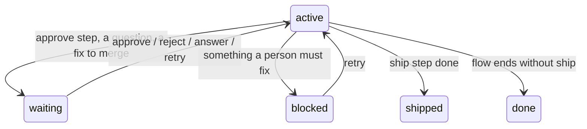

# Blocked and waiting runs

What to do when a run stops for you: approve or reject a step, answer a question, retry after a block, or reset a run.

A run is one task going through its flow. Most of the time the project's agent drives it. It stops and hands over to you in two cases:

- **waiting**: the run needs a person's decision or answer. Nothing is wrong.
- **blocked**: something went wrong that the engine and the agent may not fix alone. A person must look.

The agent tells you the message and ends its turn. A new session also shows it, for example `warden: PG-101 is blocked: <reason>. Fix it, then type "retry".`



## What to type

You type these words in the Claude Code chat. Warden reads them before the agent does. The agent cannot type them for you: the hooks stop it from running `approve`, `retry` or `reset`.

| The run says | Type in the chat | Or run in a terminal |
|---|---|---|
| waiting for you at an approve step | `approve` | `warden approve PG-101` |
| same, and you say no | `reject: <why>` | none (chat only) |
| waiting for your answer: `<question>` | your answer, as your next message | `warden retry PG-101` if you answered outside the session |
| waiting: `merge <pr or branch>, then type retry` | merge it, then `retry` | `warden retry PG-101` |
| blocked: `<reason>` | fix the cause, then `retry` | `warden retry PG-101` |

Details:

- Add the task id when several runs are live: `approve PG-101`, `reject PG-101: the plan skips the rollback`, `retry PG-101`. With one live run, or only one run in the right state, the plain word is enough. Otherwise warden says `several runs wait for this (PG-101, PG-102); type "approve <task>".`
- `reject` needs a reason after a colon. Without one warden replies `reject needs a reason; the user should type "reject: <why>".` A reject sends the run back to the latest implement step before the approve step (or else the step just before it), and the agent sees your reason.
- An answer can be any message that is not a slash command. To answer one run when several are live, start with its id: `PG-101: yes, emails must be unique` or `answer PG-101 yes`.
- The terminal commands need a real terminal (a TTY). Run from the agent's Bash tool, they stop with `warden approve is for a person: run it in a terminal` and exit 6.
- To use `warden` in a terminal, set up the alias from [Installation](../getting-started/installation.md).

## Approve steps

A flow can have an `approve` step with a prompt, for example "Approve the migration plan before any code changes." The run waits there:

```
warden: PG-104 is waiting for you: <the step's prompt>. Type "approve" or "reject: <why>".
```

1. Read what the agent did so far (the plan is in the agent's message, and in `.warden/state/PG-104/plan.md`).
2. Type `approve` to go on, or `reject: <what to change>` to send it back.

A session started with `PROJECT_AGENT=1` skips approve steps. See [Team setup](team-setup.md).

## Questions from the agent

At an agent step, the agent can stop and ask you something with `warden ask "<question>"`. The run then waits:

```
PG-101 is waiting for the user's answer: Should the email be unique?
End your turn; the run goes on with the user's next message.
```

Just answer in your next message. The run goes on at the same step, and the agent reads your answer.

In an orchestration, ticket agents cannot ask you directly. The orchestrator collects their questions and shows them in its table; your answer reaches the ticket agent as a `Note`.

## Blocked runs

Read the reason, fix the cause, then type `retry`. Common reasons:

| Reason starts with | What to do |
|---|---|
| `flaky: <command> failed, then passed on a re-run` | Fix the flaky test or its cause, then retry. |
| `fixer rounds used up` | The automatic fixer tried its limit. Look at the failing check yourself (the triage report is in `.warden/state/<task>/triage/`). |
| `merging <main> into <branch> conflicts in <files>` | Merge the main branch into the ticket branch by hand in the worktree, commit, then retry. |
| `HEAD or the tree changed while <step> ran` | Someone edited or committed while a gate ran. Do not touch the worktree during gates, then retry. |
| `check left files: <files>` | A check command left new or changed files that git does not ignore. Add them to `.gitignore` on the main branch, merge the main branch into the ticket branch, then retry. |
| `code keeps changing after the gates (3 stale proofs)` | The commit kept changing after the checks passed. Find out what changes it, then retry. |
| `reviewer unavailable` | The AI reviewer failed, or gave no usable answer, twice. Read the raw output file the reason names (under `.warden/state/<task>/review/`), check the `review` settings in `.warden/steps.json`, then retry. |
| `the ticket worktree has uncommitted changes` | Commit or remove them, then retry. |
| `setup failed after merging <main>` | Fix the setup script or the dependency problem, then retry. |
| `fix branch <branch> is checked out at <path>` | Remove that worktree, then retry. |
| `warden bug reported as <id>` | The fixer found a problem in warden itself and reported it to the warden maintainers. Wait for the fix, or reset the run. |
| `engine error in <step>` | Retry once. If it happens again, report it with `/warden:report`. |

### Who fixes the cause

You do, in your own editor or terminal. While a run is blocked at a check, review or approve step, the agent's edits in the ticket worktree are refused (`<type> step does not change code`), so asking the agent to "fix it" does not work. The agent can still read files and tell you what to change.

1. Open the ticket worktree, `<your repo>.worktrees/<task>` (`warden status` prints its path).
2. Fix the cause there and commit it on the ticket branch. For a cause on the main branch (for example a `.gitignore` line or the setup script), fix and merge it on main first; `retry` merges the latest main branch in.
3. Type `retry` in the chat.

If you would rather have the agent do the work, reset the run (below) and start the task again: the new run's implement step may change code.

What `retry` does:

- For a blocked run, it starts the current step again. For a check or review step, warden first merges the latest main branch into the ticket branch (when it has new commits), runs the setup script, then runs the gate.
- For a fix that waits to be merged, or a blocked fix landing, it tries the landing again: merge the fix into the ticket branch, run its repair commands, run the gates.

## Reset a run

Reset deletes a run's live state so you can start the task again. Use it when the run is stuck for good, or you picked the wrong flow.

1. In a terminal, in your project:

   ```bash
   warden reset PG-101
   ```

2. Confirm with `y` at `Delete live state for PG-101? [y/N]`. Add `--yes` to skip the question. It prints `{"reset":"PG-101"}`.

Reset stops a running gate, removes the fix worktrees, fix branches (`warden-fix/PG-101-*`) and temporary copies, and deletes `.warden/state/PG-101/`. **The ticket worktree and its branch stay**, with your commits. Starting the task again reuses them:

```bash
warden start PG-101 --template feature --text "..." --worktree
```

You need a reset when `warden start` says `a run for PG-101 exists (status blocked); a person can run warden reset PG-101`.

## When the agent stopped but the run is active

The run is not waiting for you; the agent just stopped. Warden normally keeps the agent going: its Stop hook sends it back to `warden next`. If the agent stops anyway, you see `warden: stopping although PG-101 is active; type "continue" to resume.` Type `continue`, or run `/warden:work PG-101`.

While a check or review gate runs, the status is `running_gate`. That is normal: the agent waits with `warden wait`. Gates can take minutes.

## See also

- [How warden works](../concepts/how-warden-works.md): runs, steps and the loop
- [Gates and self-healing](../concepts/gates-and-self-healing.md): triage, the fixer and its limits
- [For agents](../for-agents.md): what the agent does when a run waits or blocks
- [Hooks](../reference/hooks.md): why the agent cannot approve or retry
- [Troubleshooting](../troubleshooting.md)
- [Exit codes](../reference/exit-codes.md)
