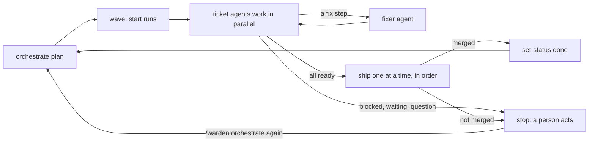

# Orchestrate an epic

Have the project's agent work through every ticket of an epic: in waves, one run and one worktree per ticket, shipped one at a time.

An **epic** is a ticket that groups other tickets. Its children can block each other (`blocked_by`). Warden sorts them into **waves**: wave 1 holds tickets that wait on nothing, wave 2 holds tickets that wait only on wave 1, and so on. Tickets in one wave are worked on in parallel. They ship one at a time, in order, so each ticket's checks run on the code it really lands on.

## Before you start

- A `tickets` tool is set up and `warden tools --check` passes. See [Write a ticket tool](write-a-ticket-tool.md).
- Every child ticket id matches `taskIdPattern` in `.warden/warden.json`.
- `.warden/` is committed and pushed on your main branch.
- Open Claude Code in the **main checkout** of your project, not in a ticket worktree.

## Steps

1. **Look at the plan first** (optional, but useful):

   ```bash
   warden orchestrate plan PG-100
   ```

   It asks the ticket tool for the epic's children, builds the waves and prints the plan as JSON. It exits 1 when `errors` is not empty. Fix the tickets until it is empty.

   | Field | Meaning |
   |---|---|
   | `tickets` | every child, with its `wave`, `template` and `phase` |
   | `waves` | the ticket ids of each wave, in order |
   | `next` | the wave to work on now |
   | `held` | tickets that wait on an open ticket outside the epic, or on a `backlog` ticket, with the blockers |
   | `backlog` | parked tickets (status `backlog`); they are never started |
   | `errors` | problems such as `cycle: PG-102 -> PG-103 -> PG-102`, `PG-104: unknown blocker PG-900`, `PG-7 does not match taskIdPattern ^PG-\d{3}$` |
   | `complete` | `true` when every child is `done` or `archived` |

2. **Start the orchestration** in Claude Code:

   ```
   /warden:orchestrate PG-100
   ```

   The first time in a conversation, the agent shows a table (wave, id, title, template, phase) and asks you to go ahead. Answer yes.

3. **Let it work.** For each ticket of the wave, the agent:

   - starts a run: `warden start <id> --template <template> --worktree`. The ticket's text becomes the task text.
   - hands each ticket to a `warden:ticket` agent, at most 4 at a time, all in the foreground.
   - hands fix steps to the `warden:fixer` agent when a check fails for a reason outside the change.
   - when the wave's work is done, ships the tickets one at a time: each ticket branch first merges the latest main branch, the gates run again on the merged commit, then the pull request is opened or merged.
   - after a merge, pulls the main branch and marks the ticket `done` with `warden orchestrate set-status <id> done`, committing the ticket file when there is one.

4. **Act when it stops.** The agent stops the wave and shows a table when a ticket needs a person. Do what the table says, then run the skill again:

   ```
   /warden:orchestrate PG-100
   ```

   It picks up where it left off. The plan is read again each time.

5. **At the end**, when every ticket is done, the agent sets the epic to `done`, runs `warden clean` to remove each shipped ticket's worktree and branch (only merged ones), and shows a final table with the result and the pull request or merge commit of each ticket.



## Ticket phases

`warden orchestrate status PG-100` prints the cached plan with each ticket's live phase. The site's Tickets page shows the tickets and their runs.

| Phase | Meaning | What happens |
|---|---|---|
| `todo` | no run yet | the agent starts one |
| `running` | the run is at an agent step or a gate | a ticket agent drives it |
| `fix` | the run is at a fix step | the fixer agent takes it |
| `ready` | the run reached the ship step and no gate is running | it ships in turn |
| `merged` | shipped and merged | marked `done` |
| `done` | the ticket status is `done` | skipped |
| `archived` | the ticket status is `archived` (closed without doing) | skipped; it never holds a dependant back |
| `backlog` | the ticket status is `backlog` (parked) | never started; tickets that wait on it are held. Move it to `todo` in your ticket system to have it worked |
| `blocked` | the run is blocked | a person fixes the cause and types `retry <id>` |
| `waiting` | the run waits for a person | type `approve <id>`, or answer its question |
| `pr-open` | shipped, but the pull request is not merged | merge it yourself |
| `no-ship` | the run finished without a ship step | look at it yourself |

## What you type when it stops

| The table says | You do |
|---|---|
| blocked | Fix the cause it names, then type `retry PG-102` |
| waiting for approve | Type `approve PG-102`, or `reject PG-102: <why>` |
| a question (`ASK`) | Answer it in your next message; the agent passes your answer on as a `Note` |
| `pr-open` | Merge the pull request |
| still `running` after 3 agent runs | Look at the run with `warden next PG-102` or the site |

Then run `/warden:orchestrate PG-100` again. See [Blocked and waiting runs](blocked-and-waiting-runs.md) for every case.

## Good to know

- Run it only when you ask for it. A new session reminds you when an orchestration stopped with tickets left: `warden: orchestration of PG-100 stopped with 2 tickets left. ...`
- If the project has a remote, the agent runs `git pull --ff-only` on the main checkout before each wave and after merges. If that fails, it stops and tells you.
- It never pushes your main branch (except the new tickets, when you give it a request instead of an epic id and it plans the epic first), never edits files in a ticket worktree and never does a ticket's steps itself.
- A ticket held by an open ticket outside the epic stays in `held` until that ticket is done.
- Each ticket's worktree is `<your repo>/.worktrees/<id>` and its branch is the id in lower case, for example `pg-102`.

## See also

- [Orchestration](../concepts/orchestration.md): the ticket DAG, waves and merge order in depth
- [Write a ticket tool](write-a-ticket-tool.md)
- [Blocked and waiting runs](blocked-and-waiting-runs.md)
- [Lead overview](lead-overview.md): watch the epic on the site
- [Skills](../reference/skills.md): `/warden:orchestrate`
