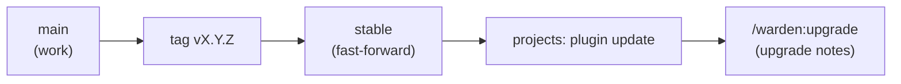

# Releasing

How to cut a warden release: bump the version, write the notes, tag it, move `stable`, and prove it on a real project before the next one.

## How a release reaches projects

Projects add the marketplace as `thucxuong/warden#stable`, so they track the `stable` branch. A commit on `main` reaches nobody until `stable` moves to it. Claude Code sees an update when the version in `plugins/warden/.claude-plugin/plugin.json` changes on `stable`.

At the project's next session start, warden prints:

- `warden: version <v> is available; this session runs <old>. ...` when the local marketplace copy is newer than the running plugin (no network is used for this);
- `warden: updated to <v>; this project is on <old>. ...` once the new plugin runs and the project's `.warden/warden.json` still names the old version. The project's agent then offers `/warden:upgrade`, which applies the upgrade notes.



## Steps

1. **Bump the version** in both files, in the release commit:

   - `plugins/warden/.claude-plugin/plugin.json` (`version`)
   - `package.json` (`version`)

   `tests/unit/manifest.test.ts` fails when they differ. Never put a version in `.claude-plugin/marketplace.json`.

2. **Add the changelog section** at the top of `CHANGELOG.md`:

   ```markdown
   ## 0.6.2 — 2026-10-20

   - One line per change, in plain words, as a project would read it.
   ```

3. **Write the upgrade note** `plugins/warden/upgrades/v0.6.2.md`. Every version gets one. It starts with `No layout changes.` when the project's files need nothing, or with a numbered list of exact edits. The project's agent applies the note word for word, so write each edit so it needs no judgement.

   `warden upgrade --notes` prints the notes of every version above the project's `wardenVersion` and up to the installed one, oldest first. `warden upgrade --done` then sets `wardenVersion`.

4. **Check everything:**

   ```bash
   bun run check
   bun run ui:check
   bun run test:ui
   bun run validate
   ```

   `check` is the type check plus the full test suite. `ui:check` fails when the committed `plugins/warden/site-dist/` is not a fresh build of `site-ui/` (run `bun run ui:build` and commit it). `test:ui` runs the Playwright tests of the site. `validate` runs `claude plugin validate --strict` on the marketplace and on the plugin.

5. **Commit** on `main`. The message starts with the version and a summary of the changes, for example `0.6.2: <what changed>`.

6. **Tag and push:**

   ```bash
   git tag v0.6.2
   git push origin main v0.6.2
   ```

7. **Fast-forward `stable`** to the tag once CI is green on the pushed commit. Never force it:

   ```bash
   git fetch origin
   git merge-base --is-ancestor origin/stable v0.6.2
   git push origin v0.6.2^{commit}:refs/heads/stable
   ```

   If `merge-base` exits 1, `stable` has commits that the tag does not. Stop and find out why.

8. **Close the reports** that the release fixes:

   ```bash
   plugins/warden/bin/warden report set <key> --status fixed --fixed-in 0.6.2
   ```

   Each project sees the new status at its next session start. See [Triage](triage.md).

9. **Re-register the doorbell** if the release changed `scripts/wa-register.ts` or the triage skill's allowed commands: `bun scripts/wa-register.ts`.

## Verify in the playground

A release is not done when the tests pass. Each version is proven on a real consumer project, the playground, before work on the next version starts.

1. Update the plugin in the playground and let its agent run `/warden:upgrade`.
2. Have the playground's agent do one to three real tickets that use what the release changed. Use a cheaper model (Sonnet or Haiku); the goal is to test warden, not to build the app.
3. The playground's agent reports what goes wrong with warden through `/warden:report` and the retro, as any project would. The doorbell triages the reports.
4. Fix the real bugs, release a patch, mark the reports fixed, and upgrade the playground again.
5. Repeat until a round finds no real warden problem. Then start the next version.

Grow the playground one ticket at a time, only as far as a warden feature needs. Its menu of possible features is in [playground requirements](../internal/playground-requirements.md). Do not spend long on a flaky test: fix it fast or set it aside.

## See also

- [Maintainers overview](README.md)
- [Triage](triage.md)
- [Contributing](contributing.md)
- [Upgrading](../getting-started/upgrading.md) (the project side)
- [Installation](../getting-started/installation.md)
