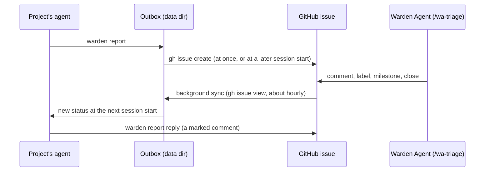

# Triage

How reports from consumer projects reach the warden maintainers, how they are judged, and how the answer goes back.

## The flow

## Words

| Word | Meaning |
|---|---|
| Report | A JSON record (`ReportRecord`, schema 1): `id`, `projectId`, `kind` (`bug` or `enhancement`), `title`, `body`, `createdAt`, `status`, `fixedIn`, `note`, `noteAt`, `issue` |
| Outbox | `<data dir>/reports/` on the machine that filed it. The data dir is `~/.claude/plugins/data/<plugin id>/`. |
| Report id | `R-<first 4 of the machine id>-NNNN`, for example `R-eb85-0001`. It is in the last line of the issue body. |
| Status | `sent`, `accepted`, `fixed`, `wontfix` or `needs-info`, read from the issue |

## Sending

- `warden report` opens the issue at once with the user's `gh`: `gh issue create -R <repo> --label <kind>`, the body plus a last line `warden report <id> · warden <version>`. A repo without the label gets the issue without one.
- **The repo** is the one warden was installed from: the marketplace's `github` source (or a `github.com` url source) in `~/.claude/plugins/known_marketplaces.json`. `WARDEN_REPORTS_REPO` overrides it. No shipped file names the repo.
- **When it cannot send** (no `gh`, not logged in, offline, no GitHub install), the report stays in the outbox with `issue: null` and the command prints `waiting` with the reason. Session start tries again each minute while a report waits, and tells the project once when `gh` is missing or logged out.
- Only reports still `sent` are opened. A report that already has a verdict but no issue (filed before issues) is never opened.
- Issues are opened only from the real plugin data dir (`~/.claude/plugins/data/...`) or when `WARDEN_REPORTS_REPO` is set. Tests use their own data dir and a fake `gh`.

## Reading back

The background sync (`warden report sync`, started by session start at most hourly) runs `gh issue view` for each open report:

| On the issue | Status |
|---|---|
| Closed as completed | `fixed`, with the milestone as fixed-in when it looks like `1.2.3` |
| Closed otherwise | `wontfix` |
| Label `needs-info`, and the last maintainer comment is newer than the project's last answer | `needs-info` |
| Label `accepted` | `accepted` |
| Anything else | `sent` |

The note is the last comment by an owner, member or collaborator, as one line of at most 500 characters. Comments by anyone else never reach the project. The project's answers start with a hidden `warden:reply` marker and never count as a note.

`warden report sync` prints `{"enabled", "sent", "refreshed", "error"}`, plus `"skipped": "busy"` when another sync holds the lock. It always exits 0. State is in `<data dir>/reports-sync.json`.

## Run triage

In a Claude Code session in the warden repo, type `/wa-triage`. It lists open issues with `warden report` in the body, decides real bug, snowflake or needs info, and answers on the issue:

| Verdict | On the issue |
|---|---|
| Real bug (or a sound enhancement) | A comment such as `Accepted. Planned for a coming release.`, label `accepted` |
| Snowflake | A comment with the cause, closed as not planned |
| Needs info | A comment with the exact question, label `needs-info` |

Nothing starts triage by itself. Run it when you see new issues, or schedule it.

The project answers a question with `warden report reply <id> --body "<answer>"` (at most 4000 characters). That posts a marked comment and sets the report back to `sent`.

## Close the loop at release

Set the milestone to the release version and close each fixed issue as completed. The project sees `report <id> "<title>" is now fixed in 0.6.2.` at its next session start, after its next sync. See [Releasing](releasing.md).

## See also

- [Maintainers overview](README.md)
- [Releasing](releasing.md)
- [Reports](../concepts/reports.md) (what the project sees)
- [CLI reference](../reference/cli.md)
- [Environment](../reference/environment.md)
