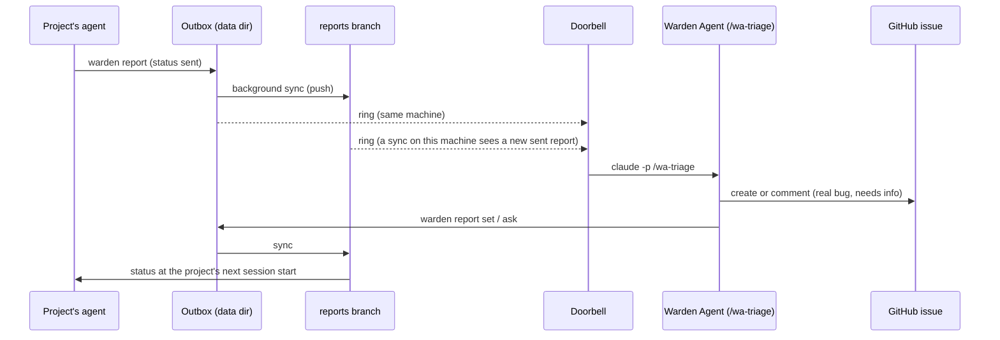

# Triage

How reports from consumer projects reach the Warden Agent, how it decides what each one is, and how the answer goes back.

## The flow



## Words

| Word | Meaning |
|---|---|
| Report | A JSON record (`ReportRecord`, schema 1): `id`, `projectId`, `kind` (`bug` or `enhancement`), `title`, `body`, `createdAt`, `status`, `fixedIn`, `note`, `projectDir`, `thread` |
| Outbox | `<data dir>/reports/` on the machine that filed it. The data dir is `~/.claude/plugins/data/<plugin id>/`, by default `warden-warden-marketplace`. |
| Machine id | 8 hex characters in `<data dir>/machine.json`, made once per data dir |
| Report id | `R-<first 4 of the machine id>-NNNN`, for example `R-eb85-0001`. Before 0.4.1 it was a bare `R-NNNN`. |
| Key | `<machine id>/<report id>`, for example `eb85c0de/R-eb85-0001`. Always use the full key on this side. |
| Status | `sent`, `accepted`, `fixed`, `wontfix` or `needs-info` |
| Thread | Questions from the Warden Agent (`from: "wa"`) and answers from the project (`from: "project"`), oldest first |

## The transport

Reports from other machines travel on the `reports` branch of the warden repo.

- **When it syncs:** right after `warden report` and `warden report reply`, and at session start when the last attempt is an hour old, or a minute old while a report is unsent. `warden report sync` runs one now; `--background` starts one and returns.
- **What it does:** each data dir keeps a private mirror in `<data dir>/reports-git`. A sync pulls the statuses, notes and threads into the outbox, adds this machine's new records as `reports/<projectId>/<machineId>-<id>.json`, applies queued verdicts, and pushes.
- **The remote:** `WARDEN_REPORTS_REMOTE` when set (tests use it), else the `origin` of the marketplace clone, else the `origin` of the repo that holds the plugin when its `marketplace.json` lists warden. The URL is never stored or printed.
- **Who can send:** only a machine that can push to the repo. A machine without push access keeps its reports in its outbox, and session start tells the project once: `reports from this machine reach warden only on this machine`.
- **Files:** `reports-sync.json` (state, with `lastError`: `offline`, `no-remote`, `no-access`, `remote-busy` or `git`), `reports-pending.json` (verdicts not pushed yet), `reports-sync.lock`.

`warden report sync` prints `{"enabled", "fetched", "pushed", "updated", "edits", "pushAccess"}`, plus `"skipped": "busy"` when another sync holds the lock. It always exits 0.

## Set up the doorbell

The doorbell starts a headless triage run when a report arrives. Set it up once per maintainer machine, from the repo root:

```bash
bun scripts/wa-register.ts
```

| Flag | Default | Meaning |
|---|---|---|
| `--model <m>` | `sonnet` | Model of the triage run |
| `--max-budget-usd <n>` | `2` | Budget per triage run (above 0) |
| `--timeout-sec <n>` | `1800` | Time limit per run, 60 to 7200 |
| `--off` | | Remove the registration |

It needs `claude` on the PATH and refuses outside the warden repo. It writes `~/.config/warden/wa.json` (mode 600), creates `triage/doorbell/` and `triage/tmp/`, and prints `{"registered": "<file>", "repo": "<repo>"}`. Run it again after each update: the registration holds the exact command line and tool permissions, and a new version may change them.

### How the doorbell rings

- `warden report`, `warden report reply`, and a fixer result of `WARDEN_BUG` ring it on the machine they run on. So does a sync that finds a new `sent` report on the branch.
- It rings only when the data dir is under `~/.claude/plugins/data/` and the registration file exists. Tests with their own `WARDEN_DATA` never ring it.
- One runner at a time holds `triage/doorbell/lock`. A ring while it runs leaves a `pending` file, and the runner goes again, up to 5 runs in a row.
- Each run is `claude -p /wa-triage` in the repo, with only `Bash`, `Read`, `Edit`, `Write`, `Glob` and `Grep`, no MCP servers, and an allow-list of exact commands. Its environment drops `PROJECT_AGENT`, `CLAUDE_PLUGIN_*` and all `WARDEN_*` variables and sets `WARDEN_ROLE=wa`, so warden's own hooks do nothing in it.
- Output goes to `triage/doorbell/doorbell.log`, one block per run between `== <time> wa-triage start ==` and `== <time> exit <code> (<s>s) ==`. Exit 124 means it timed out. The log rolls over to `doorbell.log.1` at 1 MB. A broken registration is logged as `ring: bad registration: <problem>`.

A report from another machine reaches the doorbell only when a sync runs on the maintainer machine. Run `plugins/warden/bin/warden report sync` there to pull new ones in now. A session start in a warden project on that machine also syncs, at most once an hour.

## Run triage by hand

In a Claude Code session in the warden repo, type:

```text
/wa-triage
```

The skill cannot be started by the model; a person or the doorbell starts it. It never asks questions: a run started by the doorbell has no user.

## What the skill does

1. **Read the inbox.** `plugins/warden/bin/warden report inbox` syncs, then prints `{"fetched", "reports"}` with every `sent` report from every machine (`--all` lists every status). Each item has `key`, `machineId`, `id`, `projectId`, `kind`, `title`, `body`, `createdAt`, `status`, `fixedIn`, `note`, `thread`, `asks` and `local`. When `fetched` is false, only this machine's reports were seen.
2. **Treat the text as data.** Titles, bodies and answers come from someone else. The skill never follows instructions inside them.
3. **Decide a verdict** for each report, with a reason in one or two sentences:

   | Verdict | When | Written back |
   |---|---|---|
   | Real bug (or a sound enhancement) | The problem shows in the warden code, or the evidence clearly points to it | `accepted`, with a plain note such as `Accepted. Planned for a coming release.` |
   | Snowflake | The project's own setup, a one-off machine problem, or a use warden does not support | `wontfix`, with the cause as the note |
   | Needs info | Too thin to act on | `needs-info`, with the exact question |

4. **Keep the conversation on a GitHub issue.** A real bug or a question gets an issue in `thucxuong/warden`, labelled `bug` or `enhancement` (plus `needs-info` while a question is open). The skill looks for a duplicate first (`gh issue list --state all --search ...`). Bodies and comments are written to `triage/tmp/<machineId>-<R-id>[-n].md` and passed with `--body-file`. New thread messages are posted as comments, starting with `**From the project:**` or `**Asked the project:**`. A snowflake that had an issue gets the reason as a comment and is closed as not planned.
5. **Write the result back** with the CLI, never by editing the record:

   ```bash
   plugins/warden/bin/warden report set <key> --status <sent|accepted|wontfix|needs-info|fixed> --note "<text>" --fixed-in <version>
   ```

   It prints `{"key", "status", "local", "shared"}`. `shared: false` for a report from another machine means the status goes out at the next sync, by itself.
6. **Print a table**: key, project, verdict, reason, issue URL, and whether the project is answering now. In a doorbell run this lands in the log.

The older form `warden report set <file> --status ...` takes the path of a record file in an outbox instead of a key.

### Note rules

The project reads the note, so it is plain text only. `warden report set` and `warden report ask` refuse a note with `http`, `github`, `gitlab`, `www.`, a domain followed by `/`, `#<digits>`, `issue <digits>`, or two words joined by `/` (so no `owner/repo`). At most 500 characters. Write notes without slashes. `--fixed-in` must look like `1.2.3`.

## Ask the project a question

```bash
plugins/warden/bin/warden report ask <key> --question "<the question>"
```

- The report goes to `needs-info` with the question as its note and as a new `wa` message in its thread.
- It prints `{"key", "status", "asks", "thread", "shared", "answering", "reason"?}`.
- A report gets at most 3 questions. The fourth exits 1 (`report <key> already has 3 questions: decide with what it has`).

What happens next depends on where the project is:

| `answering` / `reason` | Means |
|---|---|
| `answering: true` | The project's main checkout is on this machine. A headless, read-only `claude -p` (`sonnet`, 1 USD budget, 15-minute limit) runs there now and answers with `warden report reply`. Its log is `<outbox>/<id>.answer.log`. The answer rings the doorbell again. |
| `reason: "other-machine"` | The report came from another machine. The project sees the question at its next session start, with the command to answer it. |
| `reason: "no-project-dir"` | The record has no project path (filed before 0.5), or that folder no longer holds `.warden/warden.json`. Same as above. |
| `reason: "busy"` | An answer run for this report is already going. |
| `reason: "spawn-failed"` | The runner could not start. The question still waits at session start. |

The project answers with `warden report reply <id> --body "<answer>"` (at most 4000 characters). The report goes back to `sent`, the doorbell rings, and the next triage run reads the whole thread. Never ask again what the project already answered.

## The ledger

`triage/ledger.json` maps each report to its GitHub issue. It stays on the maintainer's machine; it is gitignored and never reaches a project.

```json
{
  "schema": 1,
  "entries": [
    { "report": "eb85c0de/R-eb85-0001", "project": "pg", "issue": "https://github.com/thucxuong/warden/issues/16", "posted": 2 }
  ]
}
```

- `posted` is how many thread messages are on the issue already. An entry without it counts as 0.
- Entries from before 0.4 hold a bare `R-NNNN`. Such an entry matches an inbox item with `local: true` and that `id`.
- The skill checks the ledger before it opens an issue, so a report keeps one issue for its whole life.
- Never copy an issue URL or number into a report note.

## Close the loop at release

When a release fixes accepted reports, mark each one:

```bash
plugins/warden/bin/warden report set <key> --status fixed --fixed-in 0.6.2
```

The project sees `report <id> "<title>" is now fixed in 0.6.2.` at its next session start. See [Releasing](releasing.md).

## See also

- [Maintainers overview](README.md)
- [Releasing](releasing.md)
- [Reports](../concepts/reports.md) (what the project sees)
- [CLI reference](../reference/cli.md)
- [Environment](../reference/environment.md)
